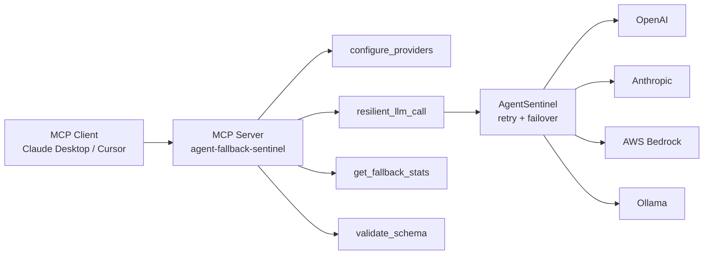

# agent-fallback-sentinel

> An **MCP server** that gives AI agents resilient LLM calls with automatic retries, provider failover, circuit-breaking, and rigid schema validation.

[](https://github.com/Jamie643/agent-fallback-sentinel/actions/workflows/ci.yml)
[](https://pypi.org/project/agent-fallback-sentinel/)
[](https://www.python.org/)
[](LICENSE)
[](https://modelcontextprotocol.io)

---

## What is this?

`agent-fallback-sentinel` is a **Model Context Protocol (MCP) server** built on the official `mcp[cli]` SDK. It exposes **four MCP tools** that let AI agents (Claude Desktop, Cursor, Zed, etc.) make resilient LLM calls without writing retry or failover logic themselves.

Under the hood, it's also a Python library that provides generic fallback middleware — but the flagship use case is the MCP server.

### MCP tools exposed

| Tool | What it does |
|---|---|
| `resilient_llm_call` | Make an LLM call with automatic retries and provider failover |
| `configure_providers` | Set the ordered provider chain (openai, anthropic, bedrock, ollama) |
| `get_fallback_stats` | Session-level stats: attempts, successes, failures, failovers |
| `validate_schema` | Validate a JSON payload against a runtime schema |

### Supported providers

- **OpenAI** (`gpt-4o-mini`, `gpt-4o`, ...)
- **Anthropic** (`claude-3-5-haiku-latest`, `claude-3-5-sonnet-latest`, ...)
- **AWS Bedrock** (Claude, Nova, Titan via the Converse API)
- **Ollama** (local models — `llama3.1`, `mistral`, ...)

If one provider rate-limits or fails, the sentinel fails over to the next. The agent just gets a result.

---

## Install

```bash
# Full install (MCP server + all providers)
pip install "agent-fallback-sentinel[mcp,providers]"

# Library only (no MCP, no provider SDKs)
pip install agent-fallback-sentinel
```

Or with `uvx` (no install needed):

```bash
uvx --from "agent-fallback-sentinel[mcp,providers]" agent-fallback-sentinel-mcp
```

---

## Use with Claude Desktop

Add this to your Claude Desktop config:

- **macOS:** `~/Library/Application Support/Claude/claude_desktop_config.json`
- **Windows:** `%APPDATA%\Claude\claude_desktop_config.json`

```json
{
  "mcpServers": {
    "agent-fallback-sentinel": {
      "command": "uvx",
      "args": [
        "--from",
        "agent-fallback-sentinel[mcp,providers]",
        "agent-fallback-sentinel-mcp"
      ],
      "env": {
        "OPENAI_API_KEY": "sk-...",
        "ANTHROPIC_API_KEY": "sk-ant-..."
      }
    }
  }
}
```

Restart Claude Desktop. You should see `agent-fallback-sentinel` under MCP servers. Ask Claude:

> *"Configure providers with OpenAI primary and Anthropic fallback, then ask each what 2+2 is."*

Claude will call `configure_providers` and then `resilient_llm_call`.

---

## Use with Cursor / Zed / other MCP clients

Any MCP client that supports stdio servers works. The command is:

```
agent-fallback-sentinel-mcp
```

---

## MCP tool reference

### `configure_providers`

Set the ordered provider chain. Tried in order; first success wins.

```json
{
  "providers": [
    {"name": "openai", "model": "gpt-4o-mini"},
    {"name": "anthropic", "model": "claude-3-5-haiku-latest"},
    {"name": "ollama", "model": "llama3.1"}
  ]
}
```

### `resilient_llm_call`

Make a resilient LLM call.

```json
{
  "prompt": "Summarize the theory of relativity in one sentence.",
  "max_retries": 2,
  "cooldown": 1.0
}
```

Returns:

```json
{
  "status": "ok",
  "provider": "openai",
  "text": "...",
  "stats": { "failovers": 0, "provider_attempts": {"openai": 1}, ... }
}
```

With schema validation:

```json
{
  "prompt": "Return the capital of France as JSON.",
  "schema_json": "{\"type\": \"object\", \"properties\": {\"answer\": {\"type\": \"string\"}}, \"required\": [\"answer\"]}"
}
```

### `get_fallback_stats`

Returns session-level counters. Useful for agents that want to know how often failover is happening.

### `validate_schema`

Validate any JSON payload against a runtime schema. Useful as a standalone tool for structuring agent output.

---

## Using the Python library directly

The MCP server is a wrapper. You can also use the library:

```python
from pydantic import BaseModel
from agent_fallback_sentinel import AgentSentinel

class Output(BaseModel):
    status: str
    action: str

sentinel = AgentSentinel(max_retries=2, cooldown=1.0)

result = sentinel.execute_with_fallback(
    primary_fn=call_openai,
    fallback_fn=call_anthropic,
    schema=Output,
)
# -> {"status": "success", "action": "retry_job"}
```

---

## Architecture



---

## Why this matters

Most agents die when an LLM provider rate-limits or goes down mid-task. `agent-fallback-sentinel` gives the agent a **stable substrate** for LLM calls:

- **Retries** transient failures with configurable backoff.
- **Fails over** to the next provider in the chain automatically.
- **Validates** output against a schema — malformed responses don't silently break the agent.
- **Reports** stats so the agent (or its operator) can see what's happening.

---

## Development

```bash
git clone https://github.com/Jamie643/agent-fallback-sentinel.git
cd agent-fallback-sentinel
python -m venv .venv && source .venv/bin/activate
pip install -e ".[dev,mcp,providers]"
pre-commit install
pytest
```

---

## Roadmap

- [x] Core retry + failover library
- [x] MCP server with 4 tools
- [ ] Streaming output support
- [ ] Prompt caching across providers
- [ ] Persistent stats across server restarts
- [ ] Web-based MCP inspector integration

---

## License

MIT — see [LICENSE](LICENSE).
